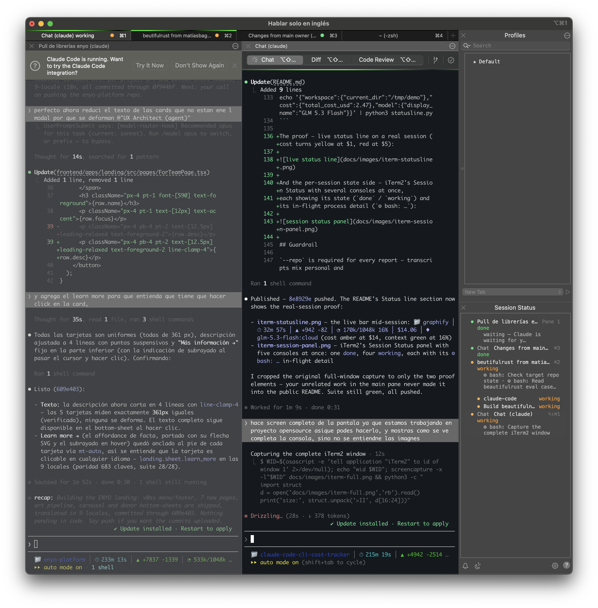
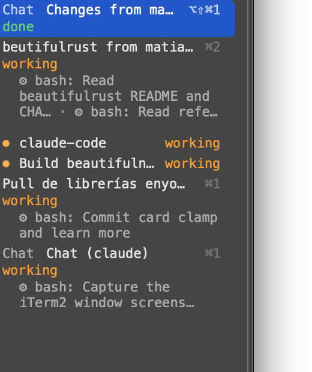

# claude-code-cli-cost-tracker

[](https://github.com/Facta-Dev/claude-code-cli-cost-tracker/actions/workflows/ci.yml)

**What does your agent work actually cost?** — Live, in your terminal, in
dollars, while you work. This tracker bills every turn of your Claude Code
sessions from the token usage Claude Code already writes to disk — whatever
backend you use, including **Ollama Cloud-backed Claude Code**, where Claude
Code's own cost figures are unavailable.

```
📁 cost-lab │ ⏱ 10m 32s │ ▲ +118 -40 │ ◔ 380k/1M ▓▓▓░░░░░ 38% │ $2.98 │ ◆ GLM 5.3 Flash
```

- **Live status line**: session cost computed per turn, incrementally — state
  by session id + byte offsets, never double-bills
- **Reports**: daily / weekly / monthly / session usage tables, JSON output
- **History baseline**: the full analyze-history report (cost-per-turn curve,
  cache-hit rate, spend by repo)
- **Slash command**: `/cccost daily --repo my-project` inside Claude Code
- **Python 3.10+ stdlib only** — no dependencies, nothing leaves your machine

| file | what it is |
| --- | --- |
| `statusline.py` | Live cost meter entry point for Claude Code's status line |
| `cccost.py` | One CLI: `daily` / `weekly` / `monthly` / `session` / `report` / `--list-repos` |
| `cccost/billing.py` | The one pricing seam: usage token classes, model resolution (`:cloud`, `[1m]`, aliases), per-turn cost, off-peak |
| `cccost/transcript.py` | Transcript shape knowledge: per-line extraction, `message.id` dedupe, session discovery, repo naming |
| `cccost/analysis.py` | Discovery-to-rows pipeline shared by every report; CSV writer |
| `cccost/reports.py` | The aggregate tables: daily / weekly / monthly / session / models |
| `cccost/merge.py` | Cross-machine export merge: sessions/turns dedupe on ids, higher-cost wins, CSV-only plumbing |
| `cccost/session_state.py` | The status line's incremental per-session billing store (byte offsets per transcript file) |
| `cccost/report.py` | The analyzer's text report (byte-compat surface) |
| `docs/architecture/` | Interactive diagrams of the implementation (module map, billing dataflow, render lifecycle) — open the `.html`, specs are the source of truth |
| `commands/cccost.md` | `/cccost` slash command for Claude Code (reports from inside a session) |
| `prices.json` | Date-stamped sheet: every priced Ollama Cloud model + all current first-party Claude models, USD per 1M tokens |
| `tests/` | Four suites (unit / contracts / integrations / e2e), plain-python runners + aggregator; fixture reproducing every awkward transcript shape |

## Quickstart

Install — macOS / Linux (Python 3.10+):

```bash
git clone https://github.com/Facta-Dev/claude-code-cli-cost-tracker
cd claude-code-cli-cost-tracker
./install.sh
```

Windows (PowerShell + Python 3.10+):

```powershell
git clone https://github.com/Facta-Dev/claude-code-cli-cost-tracker
cd claude-code-cli-cost-tracker
powershell -NoProfile -ExecutionPolicy Bypass -File install.ps1
```

Both run the test suite first, install into `~/.claude`, and print the exact
`statusLine` + hooks JSON to merge into your settings. The per-session status
(state dot + in-flight processes + 💰 cost) works natively on iTerm2 (macOS),
fires `notify-send` on Linux and toasts on Windows — see
[INSTALL.md](INSTALL.md) §3c. Details: [QUICKSTART.md](QUICKSTART.md).

## Project

- [LICENSE](LICENSE) (MIT) · [CONTRIBUTING.md](CONTRIBUTING.md) ·
  [CHANGELOG.md](CHANGELOG.md) · [install.sh](install.sh) · CI runs the
  test suite on every push (Python 3.10 / 3.12 / 3.13)

## Architecture

Static snapshots here; interactive versions (hover + trace animation) in
[docs/architecture/](docs/architecture/README.md). Specs (`.json`) are the
source of truth — edit, re-render, commit both.

**Module map** — root launchers, the `cccost/` package, data at rest:



**Billing dataflow** — transcript lines → `message.id` dedupe → the `cost()`
pricing seam → the three surfaces:


**One status-line render** — payload → incremental byte-offset billing →
state → the line, with the never-dark fallback:


## How billing works (the honest-billing rules)

- **The transcript is the source of truth.** Claude Code writes one JSONL
  line per content block of an assistant response, each repeating identical
  `message.usage`; summing lines over-bills 2–6×. Both tools deduplicate on
  `message.id` — the actual unit of billing.
- **Per-turn model pricing.** Sessions switch models mid-run; pricing follows
  the model that actually served each turn (`:cloud` tags and `[1m]` suffixes
  resolve to the bare model in the sheet).
- **Unpriced models are named, never silently dropped.** Missing rows bill
  $0 and are listed in every report; the live meter flags them with `⚠`.
- **`<synthetic>` lines** (locally generated responses) are known-free, not
  "unpriced model" noise.
- **Subagent spend folds into the parent session** (`subagents/*.jsonl`),
  live and in reports.
- **Off-peak: Ollama Cloud half-rate rows** (tagged `off_peak` in the sheet)
  halve via `--off-peak` **per turn by timestamp** — weekends, and weekdays
  outside 12:00–18:00 UTC (undated turns stay off-peak: understatement, never
  a spike). First-party Claude rows never inherit it.
- **Prices move.** The sheet is a snapshot (as of 2026-10-30). Copy, edit,
  `--prices` — never inline rates into code.

## Reports

Same billing core, four views, all behind the `--repo` guardrail:

```bash
cccost daily --repo my-project            # tokens + cost per day
cccost weekly --repo my-project           # ISO weeks
cccost monthly --repo my-project          # calendar months
cccost session --repo my-project          # one row per session
cccost report --repo my-project           # full baseline + CSVs
cccost daily --repo my-project --last 30  # window, not all history
cccost daily --repo my-project --json     # machine-readable
cccost models --repo my-project           # which model burns the budget
cccost merge machineA machineB --out-dir merged  # dedupe multi-machine exports (CSV-only)
```

## Status line

Install once (see INSTALL.md), start a session and the line appears; test
it standalone:

```bash
echo '{"workspace":{"current_dir":"/tmp/demo"},"cost":{"total_cost_usd":2.47},"model":{"display_name":"GLM 5.3 Flash"}}' | python3 statusline.py
```

The proof — the complete console: three Claude Code sessions running in parallel,
each with its own live status line (repo, time, lines changed, context, cost, model),
plus iTerm2's Session Status panel on the right tracking every session's state.



The live status line, up close (cost turns yellow at $1, red at $5):


And the per-session state side — iTerm2's Session Status with several consoles at once,
each showing its state (`done` / `working`) and its in-flight process detail (`⚙ bash: …`):



## Guardrail

`--repo` is required for every report — transcripts mix personal and
work-adjacent sessions, and a cost report is the kind of artifact that gets
pasted somewhere public. Inclusion is always explicit; `--list-repos` shows
repo names + counts only, so you can choose without reading content.
The one carve-out is `cccost merge`: CSV-only plumbing over already-billed
exports — it scans no transcripts and needs no `--repo`.

## Reduce costs further — use Terrain for free context

[**Terrain**](https://github.com/sopaco/terrain) (desktop app + CLI) cuts the
other token-cost driver: re-reading the codebase and re-explaining your
project every session.

- **Graphify knowledge graphs** — AST-only, zero LLM cost; one incremental
  `graphify update .` after changes; agents query the graph instead of
  grepping files
- **Persistent memory** — Zettelkasten vault (`~/vault`), `/resume` `/save`
  `/memorize`, and a zero-LLM `SessionEnd` autosave hook
- **Fleet cost dashboard** — Terrain's fleet table surfaces **Cost today per
  repo** using **this tracker as its preferred source** (`~/.claude/cccost.py`
  wins over the bundled ccusage), plus graph freshness and drift per project
- **One environment contract** — Skills, `AGENTS.md` snippets, CodeGraph, RTK,
  and cccost deployed to every coding agent with one click (Terrain Env tab →
  "Auto-configure everything", or `terrain env apply`)

```bash
git clone https://github.com/sopaco/terrain && cd terrain
bun install && bun run build:app      # desktop app (or `cargo build -p terrain-cli` headless)
```

## Caveats

- **Plan credits, not cash**: Ollama Cloud plans (Pro/Max/Team) spend monthly
  usage credits at these token rates — figures track credits consumed. Under
  Claude subscription plans the Claude rows are "equivalent API cost".
- **Peak rates in the live meter** — off-peak halving is `--off-peak` (analyzer) only.
- **Fast mode & Haiku tiers are sheet-driven**: a claude- turn whose usage
  speed is exactly `"fast"` bills the `-fast` row (without one: base rates +
  a note); Haiku 5.5 tiers on billed input via its `tiers` key. New tiers or
  fast variants are sheet edits, not code.
- **Merging machines**: export with `cccost report` on each machine, then
  `cccost merge DIR [DIR...] --out-dir DIR` dedupes on `session_id` /
  `(session_id, turn_index)`, keeping the higher-cost (superset) read.
  Merged CSVs are view-only data — never re-billed, never relaxing `--repo`.
- **Turn = one API request** — one prompt usually costs several turns.

## Credits

This is our own implementation — inspired by two open-source projects:

- **[cost-per-turn](https://www.youtube.com/watch?v=I2a0EJ67cVo)** — inspired
  the direction: billing turns from the token usage transcripts already
  contain. This repo's code, billing rules, price sheet, and guardrail are an
  independent implementation.
- **[ccusage](https://github.com/ccusage/ccusage)** by
  [@ryoppippi](https://github.com/ryoppippi) (MIT) — inspired the report
  views (daily / weekly / monthly / session). The report CLI here is our own
  stdlib-native build.

Try both upstreams too: ccusage for its multi-CLI, multi-source reports, and
cost-per-turn for the status-line origin story.